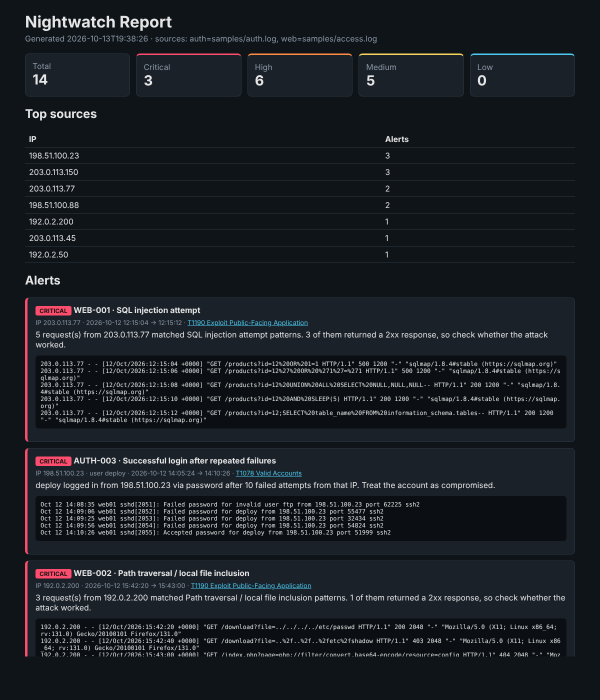

# Nightwatch

**A lightweight threat detector for Linux auth logs and web server access logs, with every alert mapped to MITRE ATT&CK and a SQLite store for SQL threat hunting.**

Nightwatch reads the logs a SOC analyst looks at every day (`/var/log/auth.log`, Apache or Nginx access logs), runs a set of detection rules over them, and produces a prioritized list of alerts as a console summary, a JSON file for SIEM ingestion, and a self-contained HTML report. It can also load everything into SQLite so you can hunt further with SQL.

It has no runtime dependencies. Everything is pure Python 3.10+ and the standard library.



## What it detects

| Rule | Detection | Severity | MITRE ATT&CK |
|---|---|---|---|
| AUTH-001 | SSH brute force: many failed logins from one IP in a short window | High | [T1110.001](https://attack.mitre.org/techniques/T1110/001/) Password Guessing |
| AUTH-002 | Password spraying: one IP trying many different usernames | High | [T1110.003](https://attack.mitre.org/techniques/T1110/003/) Password Spraying |
| AUTH-003 | Successful login from an IP that just failed repeatedly (likely compromise) | Critical | [T1078](https://attack.mitre.org/techniques/T1078/) Valid Accounts |
| AUTH-004 | Direct root login over SSH | Medium | [T1078.003](https://attack.mitre.org/techniques/T1078/003/) Local Accounts |
| AUTH-005 | Interactive root shell opened through sudo | Medium | [T1548.003](https://attack.mitre.org/techniques/T1548/003/) Sudo and Sudo Caching |
| WEB-001 | SQL injection payloads (UNION SELECT, `OR 1=1`, time-based `SLEEP`, ...) | High | [T1190](https://attack.mitre.org/techniques/T1190/) Exploit Public-Facing Application |
| WEB-002 | Path traversal and local file inclusion (`../`, `/etc/passwd`, `php://filter`) | High | [T1190](https://attack.mitre.org/techniques/T1190/) Exploit Public-Facing Application |
| WEB-003 | Cross-site scripting probes (`<script>`, `onerror=`, `javascript:`) | Medium | [T1189](https://attack.mitre.org/techniques/T1189/) Drive-by Compromise |
| WEB-004 | OS command injection (`;cat`, `\|id`, `$(whoami)`) | High | [T1059](https://attack.mitre.org/techniques/T1059/) Command and Scripting Interpreter |
| WEB-005 | Known scanner user agents (sqlmap, Nikto, Nmap, gobuster, Nuclei, ...) | Medium | [T1595.002](https://attack.mitre.org/techniques/T1595/002/) Vulnerability Scanning |
| WEB-006 | Directory brute forcing: bursts of 404s from one IP | Medium | [T1595.003](https://attack.mitre.org/techniques/T1595/003/) Wordlist Scanning |

A few details that make the detections more useful than a plain `grep`:

* **Sliding time windows.** Brute force and 404 bursts are measured inside a configurable window using an O(n) two-pointer sweep, so slow, spread-out failures don't trigger false positives.
* **Correlation.** AUTH-003 links a successful login back to the failures that preceded it from the same IP, which turns "noisy brute force" into "this account is probably compromised".
* **Severity escalation.** A web attack that got a `2xx` response is escalated one level, because the attack may have worked.
* **Decoding.** Request paths are URL-decoded twice before matching, which catches double-encoded payloads like `..%252f..%252fetc%252fpasswd`.
* **No double counting.** sshd logs both `Invalid user X` and `Failed password for invalid user X` for one attempt. Only the second counts toward brute force.
* **Safe reporting.** The HTML report escapes all log content, so attacker payloads in the logs cannot execute in the analyst's browser (there's a test for this).

## Quick start

```bash
git clone https://github.com/Kwame-w/nightwatch.git
cd nightwatch
python -m venv .venv && source .venv/bin/activate
pip install -e ".[dev]"

nightwatch --auth samples/auth.log --web samples/access.log --year 2026 \
          --html reports/report.html --json reports/report.json
```

Example output:

```
Parsed 65 auth events and 458 web requests.

[CRITICAL] WEB-001  SQL injection attempt  (T1190)
           5 request(s) from 203.0.113.77 matched SQL injection attempt patterns. 3 of them returned a 2xx response, so check whether the attack worked.
[CRITICAL] AUTH-003  Successful login after repeated failures  (T1078)
           deploy logged in from 198.51.100.23 via password after 10 failed attempts from that IP. Treat the account as compromised.
[HIGH    ] AUTH-001  SSH brute force  (T1110.001)
           40 failed SSH logins from 203.0.113.45 within 300s (40 failures total).
[HIGH    ] AUTH-002  Password spraying / username enumeration  (T1110.003)
           198.51.100.23 tried 8 different usernames within 600s: deploy, ftp, git, jenkins, oracle, postgres, test, ubuntu.
...
14 alert(s) - critical: 3, high: 6, medium: 5
```

Run it on your own machine (read access to auth logs usually needs `sudo`):

```bash
sudo nightwatch --auth /var/log/auth.log --web /var/log/nginx/access.log --html report.html
```

## Threat hunting with SQL

Add `--db` and Nightwatch also writes every parsed event and alert into a SQLite database ([schema](nightwatch/schema.sql)), so you can keep investigating with SQL the way you would in a SIEM. `nightwatch-hunt` ships seven ready-made hunting queries in [`nightwatch/queries/`](nightwatch/queries/):

| Query | What it answers | SQL used |
|---|---|---|
| `top_attackers` | Which IPs caused the most and the worst alerts, and which techniques | `GROUP BY`, `CASE`, `GROUP_CONCAT(DISTINCT)` |
| `success_after_failures` | Which successful logins followed a burst of failures (likely compromise) | CTE, correlated subquery, date arithmetic |
| `cross_vector_ips` | Which IPs attacked both SSH and the website | two CTEs + `JOIN` |
| `failed_logins_by_user` | Which accounts are targeted, from how many sources | aggregates, `COUNT(DISTINCT)` |
| `hourly_timeline` | When the attacks started, hour by hour | `UNION ALL`, conditional sums |
| `web_heavy_hitters` | Busiest web clients and their error rates | `RANK() OVER` window function, `HAVING` |
| `alerts_by_technique` | MITRE ATT&CK coverage of the dataset | grouping |

```bash
nightwatch --auth samples/auth.log --web samples/access.log --year 2026 --db hunt.db
nightwatch-hunt --db hunt.db --list
nightwatch-hunt --db hunt.db cross_vector_ips success_after_failures
nightwatch-hunt --db hunt.db --sql "SELECT path, COUNT(*) FROM web_events WHERE status = 404 GROUP BY path ORDER BY 2 DESC LIMIT 5"
```

```
== cross_vector_ips: IPs that attacked BOTH SSH and the website: a stronger signal than either alone.
ip            ssh_failures  requests  not_found  server_errors
------------  ------------  --------  ---------  -------------
203.0.113.45  40            5         5          0
(1 row)
```

Two safety details:

* **Log lines are attacker-controlled**, so every insert uses `?` placeholders. A log line containing `'); DROP TABLE alerts; --` is stored as plain text, and there's a test for exactly that.
* **Ad-hoc `--sql` runs on a read-only connection** (`mode=ro`), so a mistyped `DELETE` can't destroy the evidence.

## Options

```
--auth FILE            Linux auth.log / secure file (repeatable)
--web FILE             Apache/Nginx combined access log (repeatable)
--year YEAR            year for syslog timestamps, which omit it (default: current year)
--json FILE            write a JSON report
--html FILE            write an HTML report
--db FILE              store events and alerts in SQLite for nightwatch-hunt
--min-severity LEVEL   hide alerts below low|medium|high|critical
--fail-on LEVEL        exit with code 2 if any alert is at or above LEVEL (for CI / cron)
--no-color             disable ANSI colours

Detection tuning:
--brute-force-threshold N   --brute-force-window SECONDS
--spray-user-threshold N    --spray-window SECONDS
--compromise-failure-threshold N
--not-found-threshold N     --not-found-window SECONDS
```

## Sample data

`samples/` contains a day of generated logs for a fictional server, with benign traffic mixed with staged attacks: an SSH brute force, a password spray that ends in a successful login and a root shell, a sqlmap run, a gobuster scan, path traversal, XSS and command injection probes. Regenerate them with `python scripts/generate_samples.py`.

All IP addresses come from the RFC 5737 documentation ranges, so the samples never reference real hosts.

## Project layout

```
nightwatch/
├── parsers.py     # auth.log (syslog) and combined access log parsers -> typed events
├── detectors.py   # detection rules, sliding windows, correlation, signatures
├── models.py      # AuthEvent, WebEvent, Alert, Severity
├── report.py      # console, JSON and HTML output
├── storage.py     # SQLite persistence (parameterized inserts, read-only hunting)
├── schema.sql     # tables, constraints and indexes
├── queries/       # SQL threat-hunting queries
├── hunt.py        # nightwatch-hunt entry point
└── cli.py         # argparse entry point
tests/             # 37 pytest tests covering parsers, every rule, SQL storage and the CLI end to end
scripts/           # sample log generator
.github/workflows/ # CI: ruff, Bandit, pytest on Python 3.10-3.13, uploads a sample report
```

## Adding a rule

Detectors are plain functions with the signature `(events, cfg) -> list[Alert]`. Write the function in `detectors.py`, add it to `AUTH_DETECTORS` or `WEB_DETECTORS`, and add a test in `tests/test_detectors.py`. For a new web payload signature, just append a `WebSignature` to `WEB_SIGNATURES`.

## Limitations and ideas

* Signature-based web detection will miss novel or heavily obfuscated payloads, and can flag benign URLs that happen to contain attack-like strings. Tune or extend the patterns for your environment.
* Syslog timestamps have no year or timezone, so logs spanning New Year need splitting.
* Possible next steps: GeoIP enrichment, Windows Event Log (4625/4624) support, exporting rules as [Sigma](https://github.com/SigmaHQ/sigma), and a `--follow` mode for live tailing.

## Disclaimer

Nightwatch is a defensive, educational tool. Only analyze logs from systems you own or are authorized to monitor.

## License

MIT
